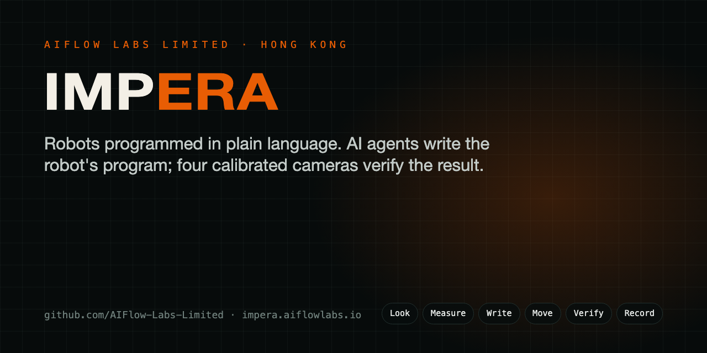

# IMPERA
**Robots programmed in plain language, verified by cameras.**

Say the task. A group of AI agents writes the robot's program. Four calibrated cameras measure whether the job was done, and keep the evidence. IMPERA is a measured manipulation bench for low-cost robot arms.

## How it works
1. **Look** — four cameras, one world frame.
2. **Measure** — object and target positions in millimetres, each with a quality score.
3. **Write** — the agents write the robot's program against the bench interface.
4. **Move** — one executor, with a workspace guard and an emergency stop enforced in software.
5. **Verify** — the result is scored from the cameras and stored with its evidence.
6. **Record** — every episode becomes a dataset.

Scores come from measurements, never from assumptions.

## Design principles
- **One hand on the arm.** One executor owns the hardware. The other agents read, measure, propose, verify and record.
- **Independent verifier.** It sees only images and measured evidence, never the program or the executor's own claim.
- **Limits stay with people.** The agents cannot change limits, rules or calibration. A finding goes to a person.
- **The program is the policy.** Readable, testable, versioned.
- **Local by design.** The whole bench runs on one computer under the desk; no cloud in the safety loop.

## Status
Software complete, awaiting hardware bring-up. The software runs today against a simulated rig with automated tests. No success rates on real hardware are claimed yet; they will be published with their sample size once measured.

👉 [impera.aiflowlabs.io](https://impera.aiflowlabs.io)

AIFLOW LABS products → [IRONWARD](https://github.com/AIFlow-Labs-Limited/ironward) · [IRONWARD-WEB](https://github.com/AIFlow-Labs-Limited/ironward-web) · [IRONWARD-WEB3](https://github.com/AIFlow-Labs-Limited/ironward-web3) · [REWIRE](https://github.com/AIFlow-Labs-Limited/rewire) · **IMPERA**

---
**AIFLOW LABS LIMITED** · Hong Kong company, registered office in Sheung Wan · Company No. 78586258
[aiflowlabs.io](https://aiflowlabs.io) · ilessio@aiflowlabs.io

This repository holds product information only. The source code is proprietary and not published here.
